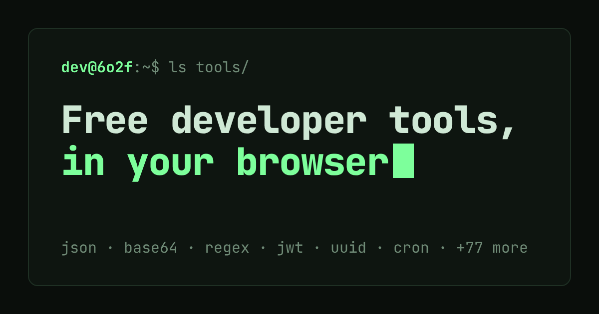

# 6o2f.dev

<p align="center">
  <a href="https://6o2f.dev"></a>
</p>
<p align="center">
  <a href="https://6o2f.dev"></a>
</p>

A hundred small developer tools, one per subdomain (`json.6o2f.dev`, `cidr.6o2f.dev`, ...), served by a single Cloudflare Worker. Most tools run entirely in the browser; the ones that store data or fetch other sites need a Discord sign-in and an admin's approval.

## How it fits together

- **One Worker** (`src/index.ts`, Hono) routes by hostname: the apex serves the launcher and sign-in, `<name>.6o2f.dev` goes to `src/tools/<name>/index.ts`. The contract every tool follows is in [CONTRACT.md](CONTRACT.md).
- **Pages** live in `public/_/<name>/` (HTML, plain ES modules, CSS) and share `public/_/ui.css` and `ui.js`. There is no build step except the mail app (`web-mail/`, Vite + React).
- **Storage:** D1 (`migrations/`, mail in `migrations-mail/`), KV (pastes, short links, clipboard, bot flags), R2 (drop files, mail), Durable Objects (webhook inboxes, device-to-device send), Workers AI.
- **Admin panel** (`admin.6o2f.dev`): users and access, published content, bots, tool on/off, analytics, audit log.
- **Bot guard** (`src/guard.ts`): honeypot paths and a hidden robots-disallowed link flag an IP for 24 hours; flagged IPs get an endless generated labyrinth.

## Develop

```sh
pnpm install
cp .dev.vars.example .dev.vars   # fill in DISCORD_CLIENT_SECRET and SESSION_SECRET
scripts/dev.sh 0                 # local server on http://localhost:8850 with migrated local D1 and a dev token
```

`scripts/dev.sh` explains how to reach a tool locally (`x-host` header plus the dev bearer token).

## Checks

```sh
pnpm check      # typecheck, lint, format check, spelling, unit tests
pnpm format     # apply Prettier
node scripts/audit.mjs --slot 0 all   # HTML / accessibility / console audit of every page (needs the dev server)
```

Unknown but correct words go in `project-words.txt`.

## Deploy

```sh
pnpm db:migrate:remote   # apply new D1 migrations first
pnpm run deploy          # builds the mail app, then wrangler deploy
```

Secrets (set with `wrangler secret put`): `DISCORD_CLIENT_SECRET`, `SESSION_SECRET`. Optional: `DISCORD_BOT_TOKEN`, `AI_MODEL`. Cron triggers: a daily sweep (expired drops, mail, stats retention) and uptime checks every 5 minutes.
